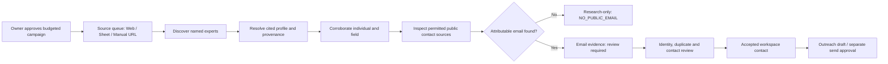

# AI-62 / #98 — Durable research-to-contact pipeline contract

Status: **architecture and acceptance contract; not a deployed autonomous worker**  
Last verified: 2026-11-17. Existing campaign observation read API and UI improvements are separate from the future background executor.

## Outcome and strict terminology

One explicit approval should launch a restart-safe, budget-bounded workflow that finds professionals and yields **usable reviewable contacts containing a name, category and attributable email**. Finding a person without an email is a research observation, **not** a Contact/Candidate. We never manufacture addresses or claim every public person has a discoverable email. A goal of 100 contacts counts only records that pass the user-approved contact intake gate; a campaign may legitimately finish PARTIAL when sources, evidence, consent, spending or time budgets are exhausted. Review is required before any invitation; discovery never sends messages.

### Inputs, all feeding one pipeline

- **Public web AI research** using approved BYOK adapter; signed/grounded provider citations are evidence hints, not proof of personal contact.
- **Google Sheets read-only import** after explicit file/tab/column selection and preview. A row with an email is still unverified user-provided information.
- **User-pasted public URLs**, singly or in bulk (profiles, websites, permitted directories). Persist the supplied URL and workspace ownership. Adding a URL to an existing campaign queues it; it does not implicitly authorize an additional paid call.

All inputs share the same normalization, workspace ACL, provenance checks, identity collision protection, email evidence review, dedupe and cost controls.

## Agent/worker stages and durable states

Each stage persists QUEUED / RUNNING / COMPLETED / BLOCKED_REVIEW / SKIPPED_RESTRICTED / FAILED_RETRYABLE / FAILED_UNCERTAIN / PARTIAL with an idempotency key, UTC timestamps, worker lease and attempt metadata. Neither an HTTP timeout nor a missing provider response authorizes re-executing a billable call. Paused uncertain tasks may be skipped without replay only under an immutable up-front authorized policy accepting the full conservative app-side charge, or after an explicit operator decision. Budget/consent/workspace revocation always stops further paid execution.

**Implement through existing `ResearchCampaign`, `ResearchCampaignTask`, `ResearchCampaignObservation`, `ResearchSpendReservation`, `Candidate`, `CandidateEvidence`, direct-email observation, and workspace membership contracts**, extending them with versioned workflow intents/stage snapshots and observation-to-contact linkage. Do not build a second ledger, parallel contact store or duplicate authorization system.

## Data acceptance

Contact intake requires a nonempty normalized name, approved category, an actual syntactically valid email and a persisted corroborating source/evidence relation to the person or explicitly labeled organization. A shared generic grounding redirect or organizational inbox cannot be asserted to belong to the named person. No name-only import. Missing email => stay a research-only finding, with reason NO_PUBLIC_EMAIL or PENDING_ENRICHMENT. Existence of email != mailbox deliverability; public listing != consent to send. Distinct `evidenceKey` != distinct identity.

Persist immutable evidence (original and resolved source URLs; provider grounding chunk indices, inspect timestamp and origin), use a constrained outbound HTTP fetcher: HTTPS, SSRF/redirect/private network protections, limits on body/content type/redirects/time, robots/ToS, no paywall bypass or gated scraping. Snapshot review digests and revocation checks before any write or outbound request.

## One approval, deterministic cost envelope

One owner-approved job intent includes workspace, target **accepted contacts**, max billable AI calls, run cap in cents, price-policy version, user-configured month cap, scope, allowed source mode and no-replay failure policy. Server enforces each bound before calls, using existing `reserveOwnerSpend` / `settleOwnerSpend` and DB locks; client never supplies pricing or provider metering data. Show:
- reserved worst-case (held funds);
- settled conservative application estimate (if provider usage incomplete);
- certified usage-derived estimate (if independently complete);
- actual provider invoice (only if separately reconciled; never inferred).

On Render use a durable server-side job runner with DB-leased tasks; browser closure, deploy or restarts must not lose progress. Enforce lease fencing, stable call idempotency where provider supports it, task ownership, concurrency limit, bounded backoff only for demonstrably pre-dispatch failures; **no automatic replay** of billable ambiguous results. Audited fail-closed recovery for orphaned reservations. Admin can stop or pause without silently refunding.

## UX / observability

Campaign dashboard displays animated but accessible stages: Plan → Discover → Validate sources → Identify people → Find email → Contact review → Ready to export/draft. Show active agent/action, counters, UTC last event, age of data, source warnings, per-stage budget and terminal result. Prefer server-provided stage snapshots with short polling/SSE fallback; never claim a local CSS animation is actual work. Respect `prefers-reduced-motion` and include screen-reader text. Separately display: discovered observations, unique person candidates, email found/unverified, contact accepted, missing email, skipped restricted, manual review, drafts, sent (disabled). Display a clear status for manual sources and Google Sheets inputs.

The existing **GET /api/research-campaigns/:id/observations** is an owner-scoped, read-only, cursor-paginated source. Use it to display existing 101 observations; do not auto-create contacts or run AI merely by opening the page. Once contact enrichment ships, add a constrained workspace-scoped projection from observation to verified contact status instead of assuming existing observations have an email.

## Test and release gates

- 101 persisted observations render without a single provider request or DB mutation.
- All 3 source modes: valid source + name + category + attributable email reaches review, **no email never creates Contact**; generic company mailbox remains separately identified.
- Shared redirect across many names and namesakes on different domains do not auto-qualify person identities.
- One owner-approved run survives tab close, restart, two concurrent workers and stale lease; never double-settles or double-sends; tenant revocation fences all transitions.
- Missing Gemini token fields preserve conservative charge; audit WHY; no fabricated refund. Exhausted budget and blocked/restricted source yield PARTIAL, not a false COMPLETED 100 contacts.
- CI: Node tests, typecheck, Vite build, disposable DB upgrade and clean-start, security, staging E2E, production smoke only after authorized release. No historical ledger rewrite, auto-invitation, paid-provider replay or deploy without explicit gate.

## Proven production smoke baseline

2026-11-17: campaign `cmwkd51nn0003dv32180at4zh` completed with 101 **research observations**, 89 distinct normalized names, 59 cited URLs, zero verified emails and zero imported campaign contacts, 16 completed research tasks, four manually skipped billing-uncertain tasks and four unstarted canceled tasks. The campaign's internal settled conservative estimate was 20 × 200 cents = $40. These are **not** 101 qualified email leads or the provider's invoice.

Related: [#62](https://github.com/pikkst/SnapyCall-Pilot-Outreach/issues/62), [#98](https://github.com/pikkst/SnapyCall-Pilot-Outreach/issues/98).
