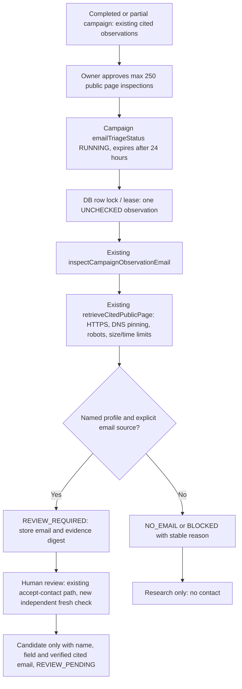

# AI-98 — Durable public email evidence triage

**Status:** feature-gated research-only stage; no automatic Candidate creation, contact approval or outreach sending.

## Purpose

Convert stored, provider-cited `ResearchCampaignObservation` rows into persisted, independently inspected **email evidence** or a reason explaining why no usable email was found. This is not a claim that a mail address is valid, belongs to the named person or can be used to send outreach. Research inputs remain separate from verified contacts: an observation with no email is **never** inserted into `Candidate`.

## Source and data pipeline

### Grounding redirect source hints (unwired building block)

`server/research-grounding-location.js` can resolve one exact Google
`grounding-api-redirect` URL using a bounded, DNS-pinned HTTPS HEAD request.
It inspects a single Location header without following the redirect or
fetching the destination. The target hostname must independently resolve to
a public IPv4 address. Invalid, private, relative, nested, inaccessible and
nonredirect targets fail closed; no paid AI provider calls are involved.

A successful result is only `SOURCE_HINT` with
`GOOGLE_GROUNDING_LOCATION_HEADER` provenance. It is **not** verified person
identity, email evidence, approved contact or sending permission. The original
provider citation must be retained separately from the destination hint.

This module is intentionally **not wired** to automated historical backfills,
triage approval, contact acceptance or any network-triggering UI action.
Before enabling source resolution for the 233 existing observations, implement
owner-scoped durable approvals, leases, immutable provenance storage, bounded
per-domain fetch rates, expiration/recovery and authenticated staging smoke.
The existing `retrieveCitedPublicPage` inspector must still enforce robots,
DNS pinning and independent person-email attribution for actual page reads.

### Trigger and constraints

- `POST /api/research-campaigns/:id/email-triage/start` with `{maxPages,confirmPublicInspection:true}` is authenticated as the campaign owner and active workspace member, uses Origin protection + rate limiter, requires terminal discovery status `COMPLETED` or `PARTIAL`, and cannot re-authorize an already attempted campaign.
- `AI_EMAIL_TRIAGE_ENABLED=true` enables the separate public-page inspection worker. It is OFF by default. Reading UI data does not trigger an inspection.
- Preflight rejects batches containing even one opaque Gemini grounding redirect or otherwise non-direct source URL; it reports the total and currently inspectable counts without consuming the immutable approval. Source resolution remains a separately audited step, not a bypass in triage.
- Max 250 observations per approval, 24-hour expiry, one active lease per campaign. The worker persists the claim before each HTTPS fetch; a crashed or expired claim blocks additional work pending review rather than automatically replaying external HTTP fetches.
- `POST /api/research-campaigns/:id/email-triage/stop` blocks future claims; a currently dispatched request can still be in flight. User cannot restart a paused approval without a separate audited recovery flow (not implemented).
- `GET /api/research-campaigns/:id/email-triage` returns counts and status; the existing owner-scoped observations read endpoint returns `emailTriageStatus`, safe reason, observed email and inspection timestamp. Never make them public.
- No model or provider key is used. Existing `ResearchCampaignRun` BYOK monetary budget and provider-call approvals are not touched by the triage worker. Any external site rate limits, access controls or blocked content remain authoritative.
- `REVIEW_REQUIRED` is evidence for the existing explicit `acceptReviewedCampaignContact` gate; no automatic CRM contact ingestion and no email sending. The accept path re-inspects the profile and checks the evidence digest to avoid stale or altered pages.
- Generic inboxes, multiple email addresses, uncited sources, shared URLs and Gemini grounding redirect links never automatically qualify as individual email evidence.

### Observability and failure contract

State is stored in existing campaign/observation rows, not a shadow contact table.

- Campaign `IDLE → RUNNING → COMPLETED`, or `RUNNING → PAUSED` on explicit stop, 24h expiry, or an expired lease.
- Observation `UNCHECKED → CHECKING → REVIEW_REQUIRED | NO_EMAIL | BLOCKED`.
- Lease/token/expiry and compare-and-set prevent stale workers from writing evidence. Stop/revocation prevents new writes. Unknown outcomes are recorded as blocked, not silently converted to qualified contacts.
- Only sanitized reason codes, counts and feature-gate status enter audit; person-associated emails are kept in tenant-scoped observation records, not logs or audit metadata.
- This implementation runs in the existing Render web process while awake. **It does not provide always-on processing** on a sleeping free instance. A separately deployed always-on worker/watchdog is required for a reliable production SLA and should reuse the same DB/claim contracts.

## Release and acceptance gates

1. CI must pass TypeScript typecheck, migration clean-start/upgrade, Node tests, mobile build, Render build and staging read-only smoke.
2. Manually verify with authenticated workspace sessions: owner only; revoked membership; two tabs; 250 cap; source with one named email; none; shared redirect; denial of public page; expired lease; stop/restart; no email delivery or billed provider call.
3. Before flipping `AI_EMAIL_TRIAGE_ENABLED`, provision worker availability, bounded external domain rate limits, operational alerting, GDPR/data-retention review for public emails, and customer-facing feature disclosure.
4. Next P0: add authorized Google Sheets rows and user-pasted URLs as normalized source objects in the same permitted inspection queue; source-to-person resolution cannot be guessed; qualify contacts only after identity and email review; target **accepted contacts** rather than raw observations.
5. Existing 233 observations are source hints. They are not 233 email contacts and will often be blocked if their only URL is a generic search-provider redirect.

See [durable discovery approvals](./ai98-durable-run-operations.md) and [full pipeline contract](./ai62-research-to-contact-pipeline.md).
